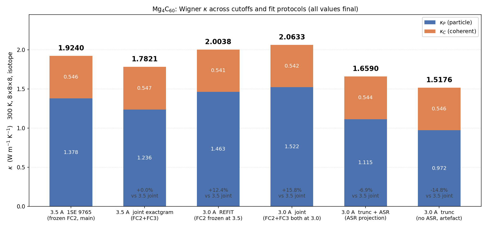

# Mg4C60 (C120Mg8) — lattice thermal conductivity: final results

Wigner RTA kappa = kappa_P (particle) + kappa_C (coherent), phono3py 3.24.0,
q-grid 8x8x8, T = 300 K, isotope scattering on. Values in W m^-1 K^-1.
Every number below comes from the phono3py hdf5 outputs / merged chunk JSONs —
nothing is hand-computed.

---

## 1. All cases

| case | c3 cutoff | protocol | fc2 md5 | fc3 md5 | support | kappa_P | kappa_C | kappa_TOT |
|---|---|---|---|---|---|---|---|---|
| 3p5A_1SE_9765 (**main value**) | 3.5 A | FC3 only, FC2 frozen | 313d0f61 | 6683f98e | 9765/16311 | 1.378284 | 0.545760 | **1.924045** |
| 3p5A_CVmin_11390 | 3.5 A | FC3 only, FC2 frozen | 313d0f61 | 054a4e82 | 11390/16311 | 1.310855 | 0.546613 | 1.857467 |
| 3p5A_1SE_9765_mesh6 | 3.5 A | FC3 only, FC2 frozen (6x6x6) | 313d0f61 | 6683f98e | 9765/16311 | 1.349515 | 0.560474 | 1.909990 |
| 3p5A_joint_82686_iso | 3.5 A | joint FC2+FC3 | f19f63f0 | 0ec23e7d | 82686/90328 | 1.185329 | 0.547494 | 1.732823 |
| 3p5A_joint_82686_iso_exactgram | 3.5 A | joint FC2+FC3 | dd90672d | 45594abf | 82686/90328 | 1.235547 | 0.546538 | 1.782085 |
| 3p5A_joint_82686_noniso | 3.5 A | joint FC2+FC3, no isotope | f19f63f0 | 0ec23e7d | 82686/90328 | 1.213508 | 0.543139 | 1.756647 |
| 3p0A_1SE_7360 | 3.0 A | FC3 only, FC2 frozen | 313d0f61 | d78fbaf2 | 7360/10540 | 1.440576 | 0.542429 | 1.983006 |
| 3p0A_joint_7683 | 3.0 A | joint FC2+FC3 | 313d0f61 | fed9fc93 | 7683/10540 | 1.521700 | 0.541578 | 2.063278 |
| **3p0A_refit_frozen35FC2** | 3.0 A | FC3 refit at c3=3.0, FC2 frozen (3.5 A) | dd90672d | 69d399b8 | 7360/10540 | 1.463046 | 0.540712 | **2.003757** |
| 3p0A_trunc30_noASR | 3.0 A | FC3 of the 3.5 A fit zeroed >3.0 A | dd90672d | truncated 45594abf | 50336 triplets | 0.971976 | 0.545611 | 1.517587 |
| 3p0A_trunc30_ASR | 3.0 A | same + ASR/permutation projection | dd90672d | truncated+projected | 50336 triplets | 1.114770 | 0.544204 | 1.658974 |

CSV: kappa_all_cases.csv (same table, machine readable).

---

## 2. What the cutoff actually does (paired comparisons)

Reference: the 3.5 A joint fit (exactgram, kappa_TOT = 1.782085).

| effect | kappa_P | kappa_C | kappa_TOT |
|---|---|---|---|
| **FC3 range 3.5 -> 3.0 A, refitted** (refit vs 3.5 joint) | +18.41 % | -1.07 % | **+12.44 %** |
| FC2 provenance (3.5 frozen FC2 -> 3.0 joint FC2) | +4.01 % | +0.16 % | +3.00 % |
| total, 3.5 joint -> 3.0 joint | +23.16 % | -0.91 % | +15.78 % |
| truncation, no ASR | -21.33 % | -0.17 % | -14.84 % |
| truncation after ASR projection | -9.78 % | -0.43 % | -6.91 % |
| support endpoint 1SE -> CV-min (3.5 A) | -4.89 % | +0.16 % | -3.46 % |
| q-grid 6x6x6 -> 8x8x8 | +2.13 % | -2.63 % | +0.74 % |
| isotope off -> on | -2.32 % | +0.80 % | -1.36 % |
| identical recipe, independent joint refit | +4.24 % | -0.17 % | +2.84 % |

**kappa_C is inert**: over all eleven runs it stays within 0.5407-0.5605
(0.5407-0.5475 excluding the coarse 6x6x6 grid), i.e. <= 1.3 % peak to peak.
Every difference in kappa_TOT is carried by kappa_P.

---

## 3. Three things to remember

1. **Zeroing a fitted FC3 breaks the acoustic sum rule.**
   max|sum_j Phi3(i,j,k)| goes from 4.2e-12 (fitted) to 3.139 (zeroed). The
   Frobenius norm of FC3 changes by only 0.0959 %, yet a single q-point chunk
   drops from kappa_P = 3.6191 to 1.3758; projecting the tensor back onto the
   ASR (phono3py set_translational_invariance_fc3 + set_permutation_symmetry_fc3)
   recovers it to 2.7551, i.e. **61.5 % of the apparent truncation effect is an
   ASR artefact**. See ASR_EFFECT_AND_TRUNCATION.md.
2. **Truncation is not a refit — even after fixing the ASR.**
   With the ASR repaired the truncated model still gives -7.1 % in kappa_TOT,
   while an actual refit at the shorter cutoff gives +12.4 %: opposite signs,
   ~20 % apart. The retained short-range coefficients were optimised in the
   presence of the long-range terms that were then removed, so they over-scatter.
   A shorter cutoff must be studied by refitting.
3. **Reproducibility floor is +-2.8 %.**
   Two independent RFE+OLS joint fits of the same data with the same recipe
   (99.86 % identical support, FC2 differing by 0.028 % in norm) give
   kappa_TOT = 1.7328 vs 1.7821. Any quantitative statement below ~3 % needs
   more than a single fit.

---

## 4. Uncertainty budget for the main value

| source | relative change in kappa_TOT |
|---|---|
| support endpoint (1SE vs CV-min) | -3.46 % |
| q-grid (6x6x6 vs 8x8x8) | +0.74 % |
| cutoff (3.0 vs 3.5 A, same frozen FC2) | -2.97 % |
| isotope on/off | -1.36 % |
| fit reproducibility (independent joint refit) | +-2.84 % |
| **quadrature sum** | **~5.4 %** |

Main value: **kappa_TOT = 1.924 W m^-1 K^-1** (principal values 0.845 / 2.232 / 2.695,
kappa_C share 28.4 %) for 3.5 A / 8x8x8 / 300 K / isotope / frozen-FC2 protocol.

---

## 5. Status

* All 3.5 A cases: final.
* 3.0 A refit (clean FC3-range effect): final, 25/25 chunks.
* 3.0 A truncation + ASR: final, 25/25 chunks (kappa_TOT 1.658974).
* 4.0 A: cancelled. A full joint 4.0 A refit needs 121438 free IFCs
  (47421 anharmonic) and >= 417 GB of RAM; the available node has 257 GB.

## 6. Where the data lives

* Fits and force constants: folders 00_shared_inputs .. 07_refit30_c3_3p0/.
* Truncation experiment: 06_trunc30_kappa/ + ASR_EFFECT_AND_TRUNCATION.md.
* This summary: 08_results/ (CSV + figure + this file).
